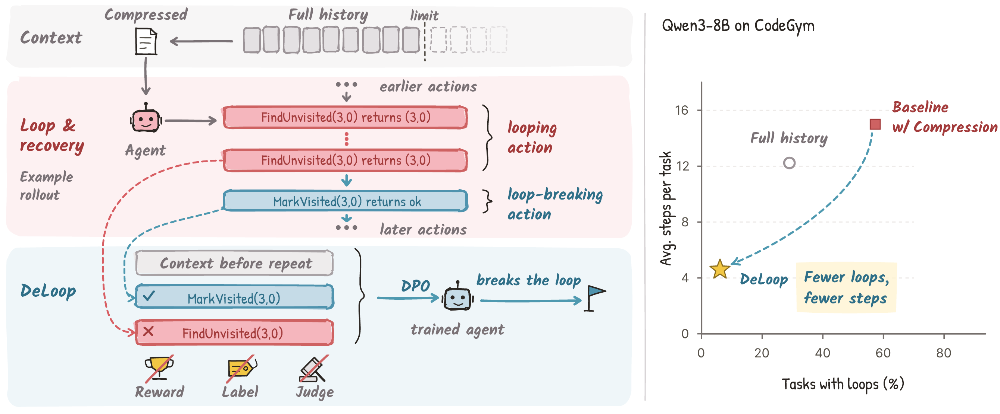
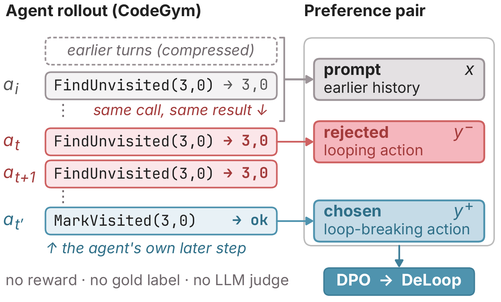

<div align="center">

# DeLoop: Repeated Actions as Self-Supervision for Long-Horizon Agents

[Tianle Chen](https://cs-people.bu.edu/tianle/)<sup>1,2</sup>,
Pushkar Singh<sup>1,†</sup>,
[Ketan Todi](https://scholar.google.com/citations?user=C08y5roAAAAJ)<sup>1</sup>,
[Biswajit Paria](https://biswajitsc.github.io/)<sup>1</sup>,
[Qijia He](https://qijia-he.github.io/)<sup>1,3</sup>,
[Wenqi Wang](https://wqwang.me/)<sup>1,2</sup>,
[Yuwen Tan](https://1yuwen.github.io/)<sup>1,2</sup>,
[Jike Zhong](https://jike338.github.io/)<sup>4</sup>,
[Sugato Basu](https://sites.google.com/site/sugatobasu/)<sup>1</sup>,
[Deepti Ghadiyaram](https://deeptigp.github.io/)<sup>2</sup>,
[Arjun Akula](https://www.arjunakula.com/)<sup>5,†</sup>

<sup>1</sup>Google &nbsp; <sup>2</sup>Boston University &nbsp; <sup>3</sup>University of Washington &nbsp; <sup>4</sup>University of Southern California &nbsp; <sup>5</sup>Google DeepMind &nbsp; <sup>†</sup>Project lead

[](https://cskyl.github.io/deloop/)
[](https://arxiv.org/abs/2610.19376)
[](https://huggingface.co/papers/2610.19376)
[](#release-status)
[](#citation)

</div>

<p align="center">
  
</p>

## Overview

Language-model agents that run long tasks often redo work they have already done: they re-issue a tool call they made earlier and get back exactly the same observation. We call this failure a **loop**. Loops appear natively in Qwen, Llama, and Gemini agents and become far more common once the agent's history is compressed to fit its context window.

**DeLoop** turns these loops into training data. Within a single rollout, the looping action is the negative example and the agent's first later loop-breaking action is the positive example. DeLoop trains on these self-mined pairs with direct preference optimization and needs **no task reward, gold answer, or LLM judge**.

## Highlights

- **Loops are common and costly.** On CodeGym, the Qwen3-8B loop rate rises from 29.0% with the full history to 57.3% under summarization at 4,096 tokens. On average over six Qwen3 and Gemini models, 59.5% of looping runs fail, against 33.4% of loop-free runs.
- **The agent often ignores a record it has.** Summaries that keep an explicit trace or ledger of past actions still loop in 52.0% to 62.7% of runs.
- **DeLoop cuts loops 9.4×.** On CodeGym under compression, the Qwen3-8B loop rate falls from 57.3% to **6.1%**, steps per task fall from 15.00 to **4.67**, and tokens per task fall by **47%**, while task success holds (25.1% → 25.9%).
- **Larger models gain task success.** Task success rises from 45.1% to **52.3%** on Qwen3-14B and from 37.7% to **44.8%** on Qwen3-32B.
- **It transfers.** With cross-domain pairs (DeLoop-Mix), Qwen3-8B success rises to **30.3%**, loops fall under seven memory policies and in ALFWorld, Open-AgentRL, AppWorld, and ScienceWorld, and the BrowseComp-Plus loop rate falls from 22.4% to **1.2%**.

## How it works

| Step | What happens |
|---|---|
| Detect | A step is a repeat when its canonicalized tool call and its observation already appeared earlier in the rollout. A repeated call with a new observation is not a loop. |
| Mine | The looping action is the rejected response. The first later action that is not a repeat and differs from it is the chosen response. Both are paired with the history before the loop. |
| Train | DPO teaches the policy to prefer the recovery over the repeat under the same context, with the frozen base policy as the reference. |

<p align="center">
  
</p>

## Release status

The paper is on [arXiv](https://arxiv.org/abs/2610.19376) and [Hugging Face Papers](https://huggingface.co/papers/2610.19376). The mining and evaluation code, the self-mined pair corpora, and the trained adapters are under review and will be released in this repository. This repository currently hosts the [project page](https://cskyl.github.io/deloop/) only.

## Citation

```bibtex
@article{chen2026deloop,
  title   = {DeLoop: Repeated Actions as Self-Supervision for Long-Horizon Agents},
  author  = {Chen, Tianle and Singh, Pushkar and Todi, Ketan and Paria, Biswajit and
             He, Qijia and Wang, Wenqi and Tan, Yuwen and Zhong, Jike and
             Basu, Sugato and Ghadiyaram, Deepti and Akula, Arjun},
  journal = {arXiv preprint arXiv:2610.19376},
  year    = {2026}
}
```

## License

The project page content is licensed under [CC BY-SA 4.0](https://creativecommons.org/licenses/by-sa/4.0/). Code and data licenses will be added with the release.
